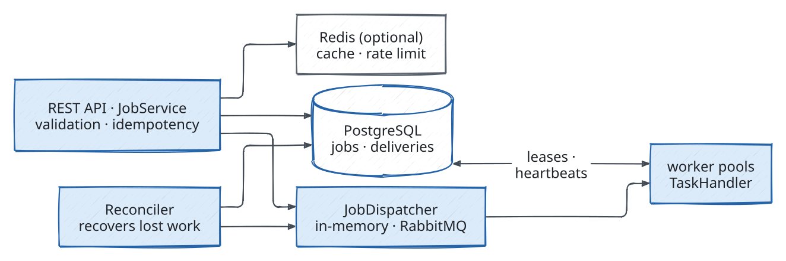

<p align="center"></p>

<p align="center">
<a href="https://github.com/AKASB1/distributed-task-platform/actions/workflows/ci.yml"></a>
<a href="LICENSE"></a>

</p>

# Distributed Task Platform

A job service that accepts jobs over HTTP, keeps their state in PostgreSQL, and runs them with retries on workers that hold a lease on each job.

<p align="center"><a href="#features">Features</a> · <a href="#getting-started">Getting started</a> · <a href="#examples">Examples</a> · <a href="#how-it-works">How it works</a> · <a href="#results">Results</a> · <a href="#documentation">Documentation</a> · <a href="#limitations">Limitations</a></p>

> **One machine.** The load-test results come from one run per mode, with the service, the load generator, and PostgreSQL on one machine ([benchmarks/README.md](benchmarks/README.md)).

Long-running and asynchronous jobs fail in awkward places. A process dies between saving a job and queueing it, a worker crashes mid-job, or a slow worker reports after its job was handed to another. Through those failures a job can run more than once, but only one attempt can finish it ([at-least-once delivery](docs/design-tradeoffs.md#at-least-once-delivery)). PostgreSQL is the only source of truth, and every state change is a compare-and-set on a version column. A dispatcher, in-memory by default or RabbitMQ, carries only job ids. Each attempt is a delivery: the worker holds its lease while heartbeats renew it and acknowledges it on success. A reconciler repairs lost work, and a job that fails all its attempts is dead-lettered. Redis is optional and never authoritative.

<p align="center"></p>

## Features

- **No job is acknowledged twice under load.** In both load-test runs of 2,000 mixed jobs on 8 worker slots, burst and paced, 0 jobs are acknowledged twice ([results](benchmarks/README.md#results-2026-10-01)).
- **Retries and dead letters follow the policy.** Both runs end with 1,966 SUCCEEDED, 20 FAILED, and 14 DEAD_LETTER jobs after 2,249 attempts and 249 retries. The Prometheus counter `taskplatform_job_retries_total` agrees (249).
- **Exactly one lease per job under contention.** The claim is a compare-and-set on the job's version, in one transaction with the delivery insert. For each of 50 jobs, 8 claimers race to claim it, and exactly one gets the lease (`RaceIT`, [failure handling](docs/architecture.md#failure-handling)).
- **A crashed worker's job is recovered.** When a worker's lease expires, the reconciler marks the delivery `EXPIRED` and retries or dead-letters the job. A late report from a worker that lost its lease is rejected (`FailureInjectionIT`, `RaceIT`).
- **Redis can fail without losing correctness.** If Redis is unreachable, idempotency falls back to PostgreSQL and rate limiting fails open (`RedisEndToEndIT`).

## Requirements

- JDK 21 (`java` on `PATH` or `JAVA_HOME` set). Maven is downloaded by the wrapper.
- Optional: Docker with Compose v2 for the container stack.
- Tests and the local run need neither Docker nor an installed PostgreSQL: they start PostgreSQL 17 from embedded binaries, downloaded from Maven Central on first use.

## Getting started

1. Build and run the tests. In Windows PowerShell:

   ```powershell
   .\mvnw.cmd -B verify
   ```

   On Linux or macOS:

   ```bash
   ./mvnw -B verify
   ```

2. Start the service without Docker. It starts an embedded PostgreSQL (data kept in `tmp/dev-postgres`) and the service on `http://127.0.0.1:18080`:

   ```powershell
   .\mvnw.cmd spring-boot:test-run
   ```

   ```bash
   ./mvnw spring-boot:test-run
   ```

3. In a second terminal, run the smoke test of the main flow (health, submit, idempotent replay, validation errors, retry, permanent failure, canceling a running job, stats, metrics):

   ```powershell
   powershell -ExecutionPolicy Bypass -File scripts\smoke.ps1
   ```

   ```bash
   ./scripts/smoke.sh
   ```

4. Stop the service with Ctrl+C in its terminal, or from PowerShell (the shutdown endpoint is enabled only by this local launcher, which binds to 127.0.0.1):

   ```powershell
   Invoke-RestMethod -Method Post -ContentType application/json http://127.0.0.1:18080/actuator/shutdown
   ```

5. Run the Docker Compose stack, the smoke test, and the crash-recovery demo:

   ```bash
   docker compose up -d --build
   ./scripts/smoke.sh
   ./scripts/crash-demo.sh
   docker compose down
   ```

   With RabbitMQ as dispatcher and Redis for the idempotency cache and rate limits:

   ```bash
   TASKPLATFORM_DISPATCHER_TYPE=rabbitmq TASKPLATFORM_REDIS_ENABLED=true TASKPLATFORM_RATE_LIMIT_ENABLED=true docker compose --profile broker --profile cache up -d --build
   ./scripts/smoke.sh
   docker compose --profile broker --profile cache down
   ```

   Ports, profiles, and the crash-recovery demo: [deploy/README.md](deploy/README.md).

If a checkout has lost the executable bit, run `chmod +x mvnw scripts/*.sh` once, or prefix the commands with `sh` or `bash` (for example `sh ./mvnw -B verify`).

## Examples

```bash
# submit (201 Created; the same Idempotency-Key and body later returns 200 with the same job)
curl -s -X POST http://127.0.0.1:18080/v1/jobs -H "Content-Type: application/json" -H "Idempotency-Key: demo-1" -d '{"type":"sleep","payload":{"durationMs":500}}'

# job with its attempt history (replace the id)
curl -s http://127.0.0.1:18080/v1/jobs/4f1c2e1a-0000-0000-0000-000000000000

# a job that fails once and is retried, and one that fails permanently
curl -s -X POST http://127.0.0.1:18080/v1/jobs -H "Content-Type: application/json" -d '{"type":"flaky","maxAttempts":3,"payload":{"durationMs":50,"failAttempts":1}}'
curl -s -X POST http://127.0.0.1:18080/v1/jobs -H "Content-Type: application/json" -d '{"type":"flaky","payload":{"failure":"permanent"}}'

# cancel (queued or running; 409 for finished jobs)
curl -s -X POST http://127.0.0.1:18080/v1/jobs/4f1c2e1a-0000-0000-0000-000000000000/cancel

# queue statistics: counts per state and the age of the oldest queued job
curl -s http://127.0.0.1:18080/v1/queues/default/stats
```

Request body of `POST /v1/jobs`:

| Field | Required | Default | Notes |
|---|---|---|---|
| `type` | yes | – | a registered handler: `sleep` or `flaky` |
| `queue` | no | `default` | `^[a-z0-9][a-z0-9_-]{0,63}$`, must be served by a worker pool |
| `payload` | no | `{}` | JSON object, at most 64 KiB |
| `maxAttempts` | no | 3 | 1–20, first attempt included |
| `timeoutMs` | no | 30000 | execution timeout per attempt, at most 1 h |

The sample handler `sleep` (`durationMs`) always succeeds. `flaky` (`durationMs`, `failAttempts`, `failure` = `retryable` | `permanent` | `hang`, optional `failProbability` + `failSeed`) fails in a configurable, deterministic way. New handlers implement `io.akasb.taskplatform.worker.TaskHandler` and are registered as Spring beans.

Responses: `201` created; `200` replayed (`Idempotent-Replayed: true`), read, or canceled (also when the job was already canceled); `400` invalid input; `404` unknown job; `409` canceling a job that already ended `SUCCEEDED`, `FAILED`, or `DEAD_LETTER`; `413` request body larger than the payload limit + 16 KiB; `415` wrong content type; `422` idempotency key reused with a different request; `429` rate limit exceeded (only when enabled; with `Retry-After`). Error bodies are RFC 7807 problem documents.

## Database compatibility

Any PostgreSQL 14 or later works; Flyway creates the schema at startup. RabbitMQ and Redis carry job ids and cache answers; they never hold job state. For example with the PostgreSQL container of the compose file (published on `127.0.0.1:15432`):

```bash
docker compose up -d postgres
./mvnw -B package -DskipTests
java -jar target/distributed-task-platform-0.1.0-SNAPSHOT.jar --spring.datasource.url=jdbc:postgresql://127.0.0.1:15432/taskplatform --spring.datasource.username=taskplatform --spring.datasource.password=taskplatform-dev
```

## Configuration

`src/main/resources/application.yml` holds every setting with its default. Override a setting with an environment variable (Spring relaxed binding, for example `TASKPLATFORM_LEASE_DURATION=10s`) or a `--name=value` argument. [configs/example.properties](configs/example.properties) lists the most useful ones.

| Setting | Default | Meaning |
|---|---|---|
| `PORT`, `BIND_ADDRESS` | 18080, 127.0.0.1 | HTTP listener |
| `spring.datasource.url` / `username` / `password` | local PostgreSQL | database (source of truth) |
| `taskplatform.lease-duration` | 30s | lease validity without a heartbeat |
| `taskplatform.heartbeat-interval` | 10s | lease renewal and progress reporting interval |
| `taskplatform.retry.initial-delay` / `multiplier` / `max-delay` / `jitter` | 1s / 2.0 / 60s / 0.5 | backoff |
| `taskplatform.retry.default-max-attempts` | 3 | when a request does not say |
| `taskplatform.reconciler.interval` / `lease-grace` / `pending-grace` / `redispatch-after` | 1s / 2s / 5s / 60s | recovery timing |
| `taskplatform.workers.pools[i].name` / `queue` / `concurrency` | `default` / `default` / 4 | worker pools |
| `taskplatform.dispatcher.type` | `in-memory` | job id transport: `in-memory` or `rabbitmq` |
| `taskplatform.rabbitmq.host` / `port` / `username` / `password` / `virtual-host` / `queue-prefix` / `prefetch` | 127.0.0.1 / 5672 / guest / guest / `/` / `taskplatform.` / 16 | RabbitMQ dispatcher (pass the password through the environment) |
| `taskplatform.redis.enabled` / `uri` / `timeout` / `idempotency-ttl` | false / `redis://127.0.0.1:6379` / 500ms / 24h | optional Redis (cache + rate-limit counters) |
| `taskplatform.rate-limit.enabled` / `requests-per-window` / `window` | false / 100 / 1s | per-client limit on `POST /v1/jobs` (Redis counters if Redis is enabled, else per instance) |
| `LOG_FORMAT` | `logstash` | JSON log layout (`logstash`, `ecs`, `gelf`) |

## How it works

Every state change of a job is a compare-and-set (`UPDATE ... WHERE id = ? AND version = ?`). Each attempt is its own `deliveries` row with the lease owner, the lease deadline, and the acknowledgement state ([docs/architecture.md](docs/architecture.md)).

- Job states: `PENDING`, `QUEUED`, `RUNNING`, `RETRY_WAIT`, `SUCCEEDED`, `FAILED`, `DEAD_LETTER`, and `CANCELLED`; Flyway migrations create the schema.
- Leases and heartbeats: a worker leases a job for `lease-duration`, and its heartbeats renew the lease and carry progress.
- Retries: capped exponential backoff with bounded, seedable jitter and a maximum number of attempts. A retryable failure waits in `RETRY_WAIT`; a non-retryable one ends `FAILED`; an exhausted job is dead-lettered. Attempts have timeouts, and queued and running jobs can be canceled.
- Reconciler: recovers jobs that were saved but never queued, and jobs queued but never dispatched or lost with the in-memory queue on a restart. It also recovers running jobs with an expired lease (a crashed worker) and due retries.
- Workers run in-process, one pool per queue with configurable concurrency, behind the `WorkerProtocol` interface; handlers implement `TaskHandler`.
- Observability: Micrometer metrics in Prometheus format at `GET /actuator/prometheus` cover queue and execution latency, retries, worker utilization, finished jobs by outcome, and stale leases. JSON logs carry `jobId`, `attempt`, `queue`, and `workerId`.

| Metric | Type | Labels |
|---|---|---|
| `taskplatform_job_queue_latency_seconds` | histogram | `queue` |
| `taskplatform_job_execution_latency_seconds` | histogram | `queue`, `outcome` (acked, nacked, expired) |
| `taskplatform_job_retries_total` | counter | `queue`, `reason` |
| `taskplatform_jobs_finished_total` | counter | `queue`, `outcome` (`succeeded`, `failed`, `dead_letter`, `cancelled`) |
| `taskplatform_job_attempts_total` | counter | `queue`, `outcome` |
| `taskplatform_jobs_submitted_total` | counter | `queue` |
| `taskplatform_leases_expired_total` | counter | `queue` (stale leases reclaimed) |
| `taskplatform_reconciler_recovered_total` | counter | `kind` |
| `taskplatform_worker_utilization` | gauge | `pool`, `queue` (busy slots / slots) |
| `taskplatform_worker_busy`, `taskplatform_worker_slots` | gauge | `pool` |
| `taskplatform_worker_busy_time_seconds_total` | counter | `pool` |
| `taskplatform_queue_depth` | gauge | `queue` (-1 if the dispatcher cannot tell) |
| `taskplatform_redis_idempotency_lookups_total` | counter | `result` (hit, miss), only with Redis |
| `taskplatform_redis_errors_total` | counter | `operation` (Redis failures answered by failing open) |
| `taskplatform_ratelimit_rejected_total` | counter | submissions rejected with 429 |

## Results

The load test submits 2,000 mixed jobs to one worker pool with 8 slots, once as a burst and once paced at 30 jobs/s ([benchmarks/README.md](benchmarks/README.md)). It uses seed 42, 3 attempts per job, the in-memory dispatcher, a 30 s lease, and a 10 s heartbeat:

| Measure | Burst | Paced 30 jobs/s |
|---|---|---|
| final states | 1,966 SUCCEEDED, 20 FAILED, 14 DEAD_LETTER | 1,966 SUCCEEDED, 20 FAILED, 14 DEAD_LETTER |
| jobs acknowledged twice | 0 | 0 |
| attempts / retries | 2,249 / 249 | 2,249 / 249 |

Throughput, makespan, and the latency percentiles are on the [results page](benchmarks/README.md#results-2026-10-01), next to the hardware they were measured on.

## Evaluation protocol

- One seeded workload (`java.util.Random`, seed 42): 70 % short, 25 % medium, and 5 % long jobs; about 10 % fail transiently and 1 % permanently.
- One run per mode, burst and paced.
- Latencies come from the delivery timestamps the service stores; percentiles use the nearest-rank method over all attempts.
- The totals are cross-checked with the Prometheus counters scraped at the end.
- Correctness under races and crashes comes from the integration tests (`RaceIT`, `FailureInjectionIT`).

## Limitations

- The load test ran once per mode on one machine, before the code-review fixes and later additions.
- The Kubernetes manifests are validated with kubeconform but were never applied to a cluster.
- Work sharing across instances needs the RabbitMQ dispatcher, which was not load-tested.
- Not built: gRPC workers, OpenTelemetry tracing, API authentication, idempotency-key expiry.

Further limitations: [benchmarks/README.md](benchmarks/README.md#limitations).

## Documentation

- [docs/architecture.md](docs/architecture.md): modules, data model, state machine, data flow, failure handling, observability.
- [docs/design-tradeoffs.md](docs/design-tradeoffs.md): at-least-once delivery, lease length, outbox, polling, idempotency, and more.
- [benchmarks/README.md](benchmarks/README.md): the load test, its results and raw output, and the limitations.
- [deploy/README.md](deploy/README.md): Compose profiles, the crash-recovery demo, Kubernetes manifests.
- [IMPLEMENTATION.md](IMPLEMENTATION.md), [configs/example.properties](configs/example.properties), and [CONTRIBUTING.md](CONTRIBUTING.md).

## Building the source

`./mvnw -B verify` runs the unit tests (surefire, `*Test`) and the integration tests (failsafe, `*IT`: real PostgreSQL, the HTTP API on a random port, races, and failure injection). The RabbitMQ and Redis integration tests use Testcontainers and skip themselves when Docker is not available; everything else needs no Docker. `scripts/repeat-concurrency-tests.ps1` and `scripts/repeat-concurrency-tests.sh` repeat the concurrency test classes (20 consecutive runs by default). `./mvnw -B -Pload test` runs the load test.

## Project layout

```text
src/main/java/io/akasb/taskplatform/
  api/            REST endpoints, JobService (validation, idempotency), error mapping
  domain/         job model, state machine, deliveries, retry policy (no framework code)
  dispatch/       JobDispatcher, in-memory queue, JobLifecycle, Reconciler (no Spring types)
  dispatch/rabbitmq/  RabbitMQ JobDispatcher adapter (plain amqp-client)
  cache/          Redis idempotency cache and rate limiter (Lettuce), fail open
  persistence/    JobRepository contract, PostgreSQL (JDBC) and in-memory implementations
  worker/         worker protocol, worker pool, task handler API, sample handlers
  observability/  lifecycle events, Micrometer metrics, log context
  config/         Spring wiring and properties
src/main/resources/db/migration/   Flyway schema
src/test/java/...                  unit tests, *IT integration tests, bench/ load test, LocalDevApplication
scripts/          smoke tests, crash demo, repeated concurrency runs, diagram, icon
benchmarks/       load-test notes and raw results
deploy/           deployment notes, Kubernetes manifests (k8s/, k8s-overlays/)
docs/             architecture, design trade-offs, diagram source, figures, icon
```

## Related projects

- [temporalio/temporal](https://github.com/temporalio/temporal): a durable execution server that runs workflows and activities with timeouts, retries, and heartbeats. This project is one Spring Boot service with a REST job API and PostgreSQL as its only state store.
- [celery/celery](https://github.com/celery/celery): a distributed task queue for Python with pluggable brokers, retries, routing, and worker pools. This project keeps job state in PostgreSQL with compare-and-set updates, and its optional broker carries only job ids.
- [rq/rq](https://github.com/rq/rq): a small Redis-backed job queue and worker for Python. This project uses PostgreSQL leases, one delivery row per attempt, and a reconciler, with Redis only as an optional cache.
- [kagkarlsson/db-scheduler](https://github.com/kagkarlsson/db-scheduler): a Java task scheduler library that persists executions in one database table, with heartbeats and dead-execution detection. This project is a standalone service with an HTTP API, an explicit job state machine, and a dispatcher interface.

They were read for design only; this repository implements a smaller system from first principles and contains no code from them.

## License

MIT, see [LICENSE](LICENSE).
